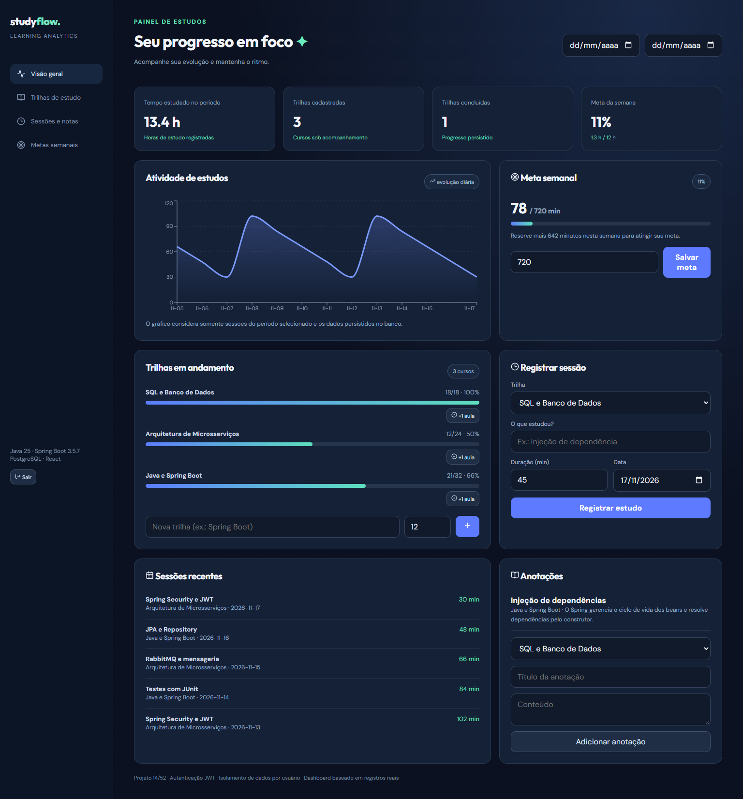

# Dashboard de Acompanhamento de Estudos — Projeto 14/52



Aplicação full-stack para acompanhar trilhas de estudo, aulas concluídas, sessões, anotações e metas semanais, com **Java 25, Spring Boot 3.5.7, Spring Security/JWT, PostgreSQL 17, React e Recharts**.

## Funcionalidades

- Registro/login com BCrypt e JWT HS256; todas as operações filtradas pelo usuário autenticado.
- CRUD básico de trilhas (criar, listar, registrar progresso, excluir).
- Sessões com minutos, assunto, curso e data; histórico ordenado.
- Anotações relacionadas a cada trilha.
- Meta semanal configurável e indicadores baseados em dados persistidos.
- Dashboard com filtros de período, horas, progresso, gráfico diário e recomendação por regras.

## Executar

Requisito: Docker Desktop com Docker Compose.

```powershell
docker compose up --build -d
```

- Interface: **http://localhost:5174**
- API: **http://localhost:8084/api/health**
- Registrar conta na interface e começar a usar.

### Principais endpoints

| Método | Endpoint | Função |
|---|---|---|
| POST | `/api/auth/register` | Criar usuário |
| POST | `/api/auth/login` | Obter JWT |
| GET/POST | `/api/courses` | Consultar/criar cursos |
| PUT | `/api/courses/{id}/progress` | Atualizar aulas concluídas |
| DELETE | `/api/courses/{id}` | Excluir curso próprio |
| GET/POST | `/api/sessions` | Sessões de estudo |
| GET/POST | `/api/notes` | Anotações |
| PUT | `/api/goal` | Meta semanal |
| GET | `/api/dashboard?from=YYYY-MM-DD&to=YYYY-MM-DD` | Indicadores |

Rotas protegidas usam `Authorization: Bearer <token>`.

## Testes e evidência

```powershell
cd backend
mvn -B clean verify
```

O script `PUBLICAR-14-15.ps1` do pacote de entrega compila o Docker, valida `/api/health`, registra uma conta demonstrativa, cria **registros reais via API**, captura a **interface React em execução** com Playwright e publica a imagem versionada `docs/images/funcionamento.png`. A imagem não é um mockup.

O GitHub Actions realiza o build/teste Maven e o build React em cada push.

## Limites do MVP

Senha demo do Postgres e configuração local são destinadas **exclusivamente ao desenvolvimento**. Em produção, use secret manager, TLS, rotação/refresh tokens, recuperação de conta, observabilidade e testes de integração da API/isolamento entre usuários. A recomendação de estudos usa regras, não um modelo de IA.
